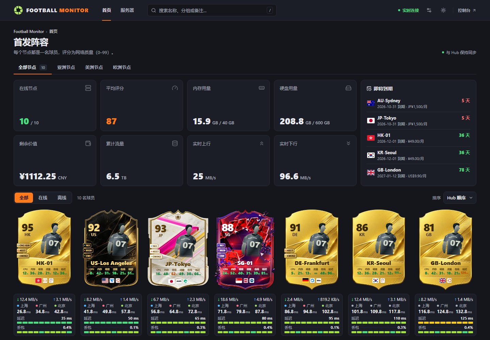
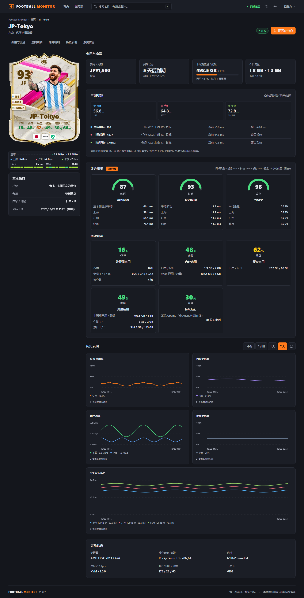
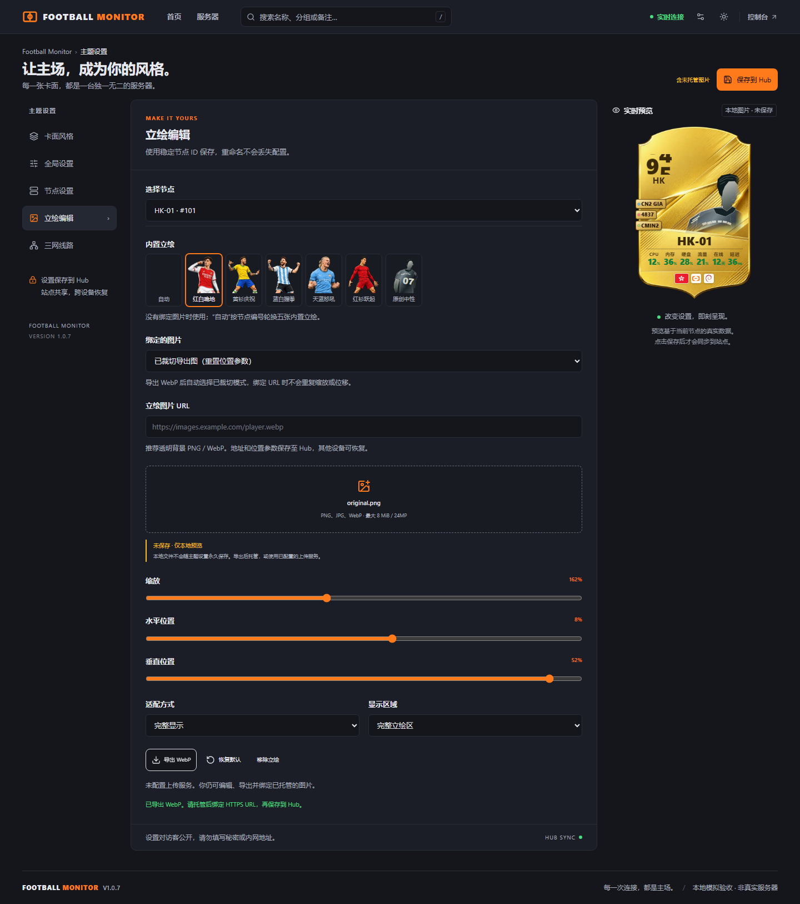
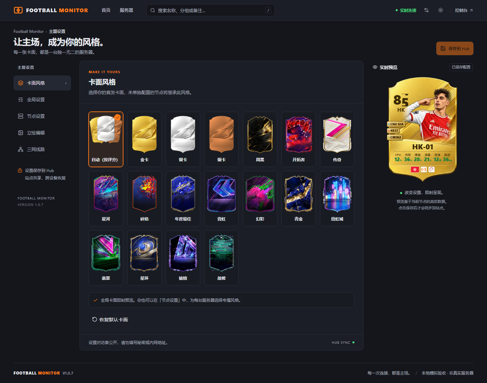
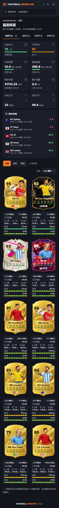
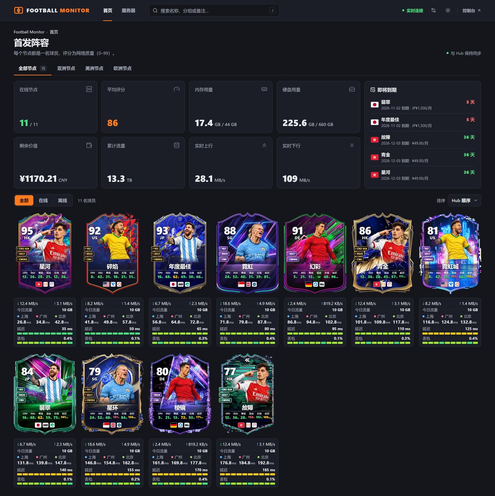
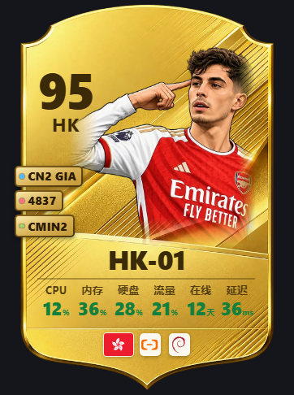
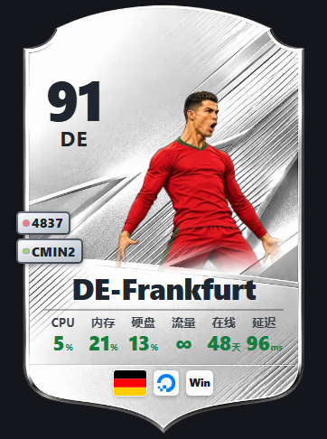
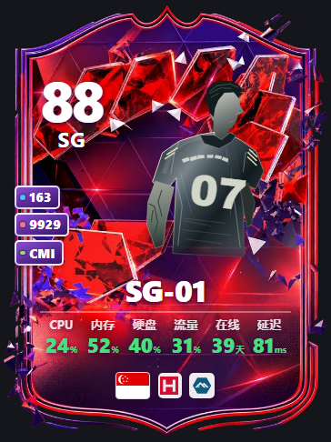

### Football Monitor

为极简探针 Monitor 打造的足球球星卡主题：每台服务器都是一名球员，**你的服务器，你的主场**。

由 [NSJLUCAS](https://github.com/NSJLUCAS) 维护，当前版本 `1.0.7`。

[](preview.png)

## 特性

- 🃏 **FC 风格球星卡**：综合分、国家/地区、线路徽章、立绘、六项真实数值（CPU / 内存 / 硬盘 / 流量 / 在线 / 延迟），底部带国旗、VPS 服务商与系统 LOGO。
- 🎨 **十七套卡面**：金卡、银卡、铜卡、周黑、开拓者、传奇，以及星河、碎焰、年度最佳、霓虹、幻彩、青金、霓虹城、翡翠、星环、棱镜、故障，另有「自动」按评分在铜 / 银 / 金之间切换。
- 📶 **网络质量评分**：基于探针后台前三个测速任务的 24 小时延迟、抖动、丢包计算，1–99 分。
- 📡 **三网延迟与丢包**：卡下实时条显示上下行速率、三个测速点延迟，以及延迟 / 丢包色块条。
- ⚡ **实时推送**：原生 WebSocket，支持 gzip 解码、断线轮询与自动重连，页面隐藏时暂停。
- 📊 **首页汇总**：在线节点、平均评分、内存/硬盘用量、剩余价值、累计流量、实时上下行，以及即将到期排行。
- 🧑 **球员资料页**：节点详情含大卡、分区导航、评分明细、历史曲线与系统信息。
- 🖼️ **自定义立绘**：内置 5 张默认立绘，也可裁切、缩放并导出 WebP 后绑定自己的 HTTPS 图片。
- ⚙️ **可视化设置**：站长登录后在页面内调整卡面、布局、外观，支持单节点覆盖，保存后读回校验。
- 📱 **响应式布局**：桌面每行最多 8 张卡，手机每行 2 张；支持键盘操作与减少动态效果。

## 截图

|                      节点详情                      |                        立绘编辑                        |
| :------------------------------------------------: | :----------------------------------------------------: |
|  |  |

|                    主题设置                     |                    手机端                     |
| :---------------------------------------------: | :-------------------------------------------: |
|  |  |

11 套特殊卡面：



原有六套卡面：

|                      金卡                       |                     银卡                     |                   铜卡                    |
| :---------------------------------------------: | :------------------------------------------: | :---------------------------------------: |
|          |     |  |
|                    **周黑**                     |                  **开拓者**                  |                 **传奇**                  |
|  |  |  |

> 截图来自本地模拟 API（`dev/mock-server.ts`），不代表真实服务器数据。

## 安装方法

### 方式一：从 GitHub 安装（推荐）

1. 登录 Monitor Hub 管理后台，进入「主题」页面
2. 填入 `https://github.com/NSJLUCAS/football-monitor`，点击「从 GitHub 安装」
3. 选择 Football Monitor；之后可在卡片上「从 GitHub 更新」

### 方式二：面板上传安装

1. 到 [Releases](https://github.com/NSJLUCAS/football-monitor/releases) 下载 `theme.tar.gz`（不是 Source code）
2. 登录 Hub 管理后台，进入「主题」页面
3. 上传 `theme.tar.gz`，然后在后台选择 Football Monitor

### 方式三：服务器目录放置

```bash
# 解压 football-monitor.tar.gz，得到 football-monitor/ 目录
tar -xzf football-monitor.tar.gz -C /opt/monitor/data/themes/
```

放入 Hub 的 `--themes` 目录后，在后台选择该主题即可。可用 `sha256sum -c SHA256SUMS.txt` 校验下载。

## 本地开发

需要 Node.js 22.22+ 或 24 LTS，使用 npm 安装依赖：

```bash
npm ci
npm run dev:mock   # 终端 1：本地模拟 API（仅开发使用）
npm run dev        # 终端 2：http://127.0.0.1:5173
```

连接测试 Hub 时只启动开发页面，并指定代理目标：

```bash
MONITOR_HUB=https://your-test-hub.example.com npm run dev
```

提交前运行全部检查：

```bash
npm run check && npm test && npm run build && npm run test:e2e && npm run package:check
```

## 构建主题包

```bash
npm run build && npm run package
```

产物包含 Hub 安装包与目录包：

```
release/hub-install/theme.tar.gz   # Hub 安装包：根部为 theme.json、preview.png、dist/
theme.tar.gz                       # 目录包：根部为 football-monitor/
release/SHA256SUMS.txt             # SHA-256 校验
```

打包后可运行 `npm run package:check` 校验压缩包结构、资源与大小限制。

## 配置与使用

主题设置统一保存到 `/api/themes/football-monitor/config`，**公开可读**，请勿填写密码、Token 或内网地址。立绘上传服务、评分算法、三网探测配置、兼容性与维护说明见 [详细手册](docs/manual.md)，可选的 Cloudflare R2 上传 Worker 见 [上传服务说明](docs/upload-service.md)。

## 技术栈

| 类别 | 技术                                 |
| ---- | ------------------------------------ |
| 框架 | Vue 3（Composition API）+ TypeScript |
| 构建 | Vite 7                               |
| UI   | shadcn-vue + Reka UI                 |
| 样式 | Tailwind CSS 4                       |
| 状态 | Pinia                                |
| 路由 | Vue Router                           |
| 图标 | Lucide、flag-icons、simple-icons     |
| 测试 | Vitest + Playwright                  |

## 鸣谢

- 极简探针 Monitor 及其主题机制
- 金卡、周黑、开拓者、传奇卡面与 5 张默认立绘由站长提供；立绘为真实球员插画，肖像与商标归各自权利人所有，详见 [THIRD_PARTY_NOTICES.md](THIRD_PARTY_NOTICES.md)
- 版式参考 FUT.GG；本项目与 EA 无隶属关系，不使用 EA 的素材、商标或字体

## License

[MIT](LICENSE)（内置立绘除外，见上）
